<p align="center">
  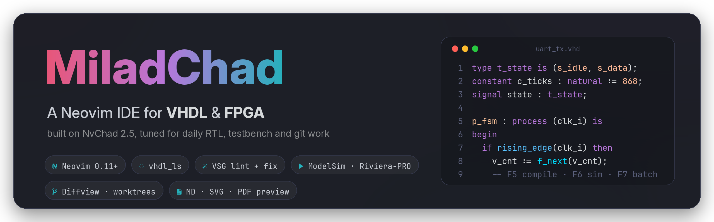
</p>

<p align="center">
  
  
  
  
</p>

<p align="center">
  <b>MiladChad</b> is my personal Neovim setup for writing, linting, simulating and reviewing VHDL every day.<br>
  It starts on NvChad 2.5 and adds a language server, VSG, simulator keys, VSCode-style git tools and fast previews.
</p>

<p align="center">
  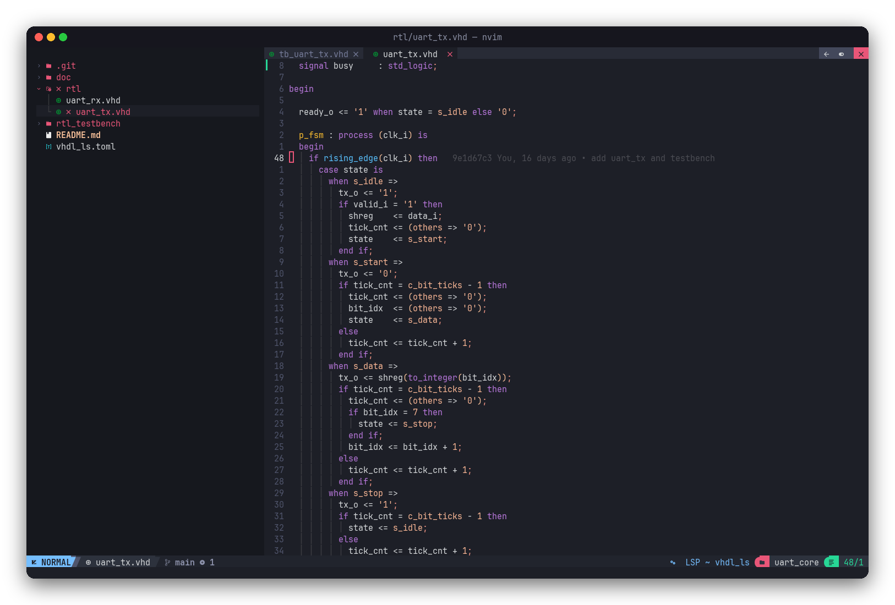
</p>

---

## Contents

- [Why this config](#why-this-config)
- [A tour](#a-tour)
  - [VHDL editing](#vhdl-editing)
  - [FPGA tasks](#fpga-tasks)
  - [Git: blame, diffs, worktrees](#git-blame-diffs-worktrees)
  - [Finding and jumping](#finding-and-jumping)
  - [Previews](#previews)
  - [The built-in Vim course](#the-built-in-vim-course)
- [Installation](#installation)
- [VHDL setup](#vhdl-setup)
- [Keybindings](#keybindings)
- [What is in the box](#what-is-in-the-box)
- [Repository layout](#repository-layout)
- [Make it yours](#make-it-yours)
- [License](#license)

---

## Why this config

<p align="center">
  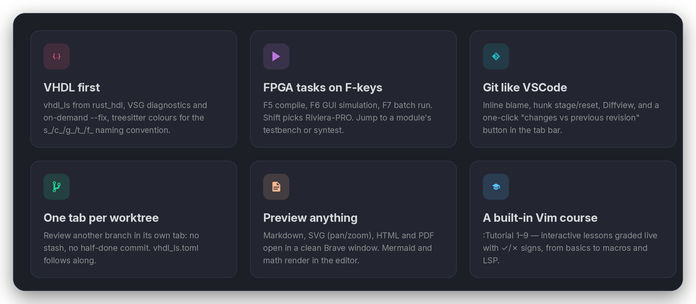
</p>

I used VSCode for RTL work for a long time. This config moves my whole flow into the terminal:

- **The editor knows VHDL.** `vhdl_ls` gives go-to-definition, rename, completion and semantic errors across the project. VSG shows style problems as diagnostics. Names get colours from the prefix convention I use (`s_`, `c_`, `g_`, `t_`, `f_` …).
- **The compile/simulate loop is one key.** <kbd>F5</kbd>, <kbd>F6</kbd> and <kbd>F7</kbd> do the same as the VSCode tasks did: compile, open the simulator GUI, run in batch mode. With <kbd>Shift</kbd> they use Riviera-PRO instead of ModelSim.
- **Git review without leaving the file.** You get inline blame, hunk staging, Diffview, and a button for *changes vs previous revision* that works like GitLens. Each worktree opens in its own tab.
- **It stays fast.** Plugins load lazily. Completion uses blink.cmp. Linters skip buffers that have not changed. VSG costs about 3 s of CPU on a 2600-line file, so it runs only when the text has changed.

---

## A tour

### VHDL editing

<p align="center">
  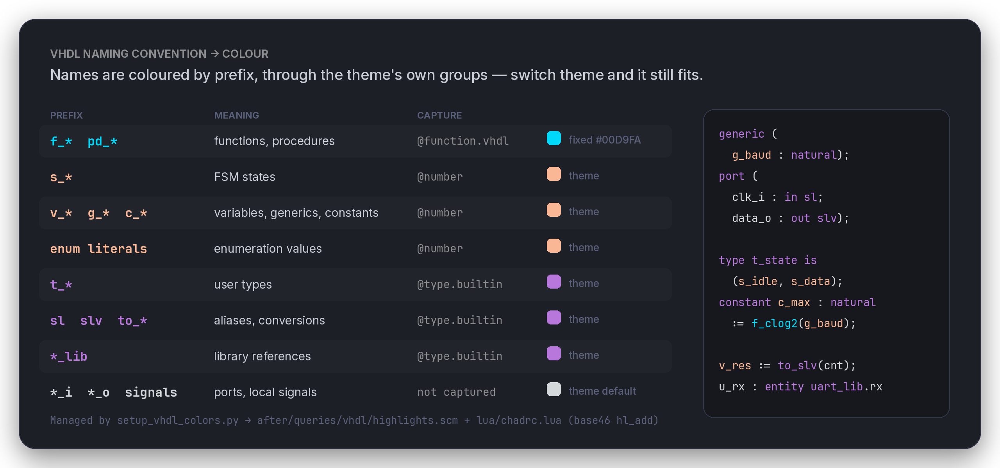
</p>

Names are coloured by **prefix**. Each prefix maps to a highlight group that the theme already has (`@number`, `@type.builtin`). Only `f_*` / `pd_*` functions have a fixed colour. When you change the theme with <kbd>Space</kbd> <kbd>t</kbd> <kbd>h</kbd>, the VHDL colours change with it. The rules live in `after/queries/vhdl/highlights.scm`. `setup_vhdl_colors.py` regenerates them.

<table>
  <tr>
    <td width="50%">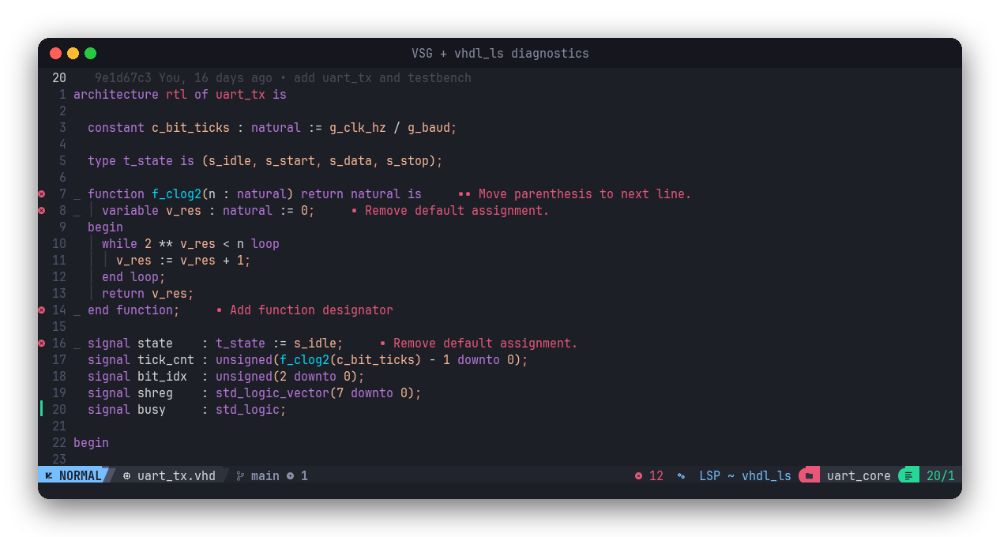</td>
    <td width="50%">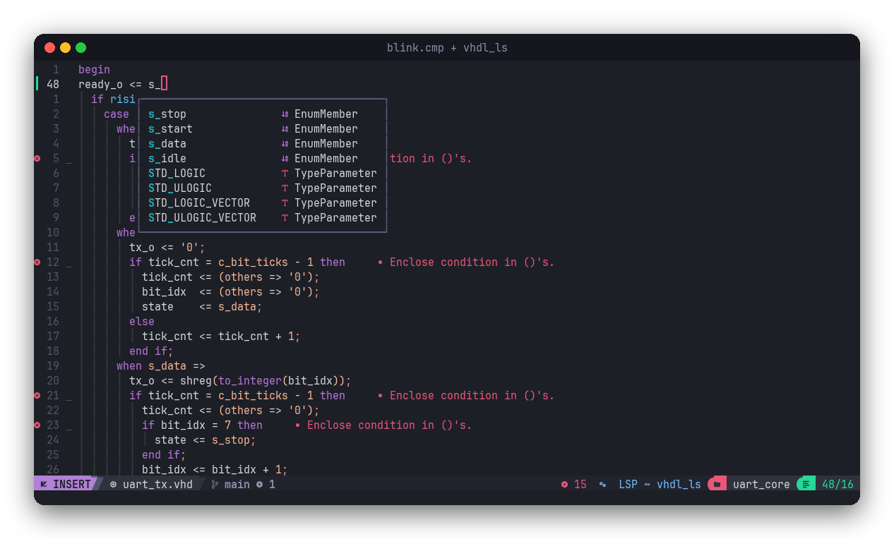</td>
  </tr>
  <tr>
    <td align="center"><b>VSG + vhdl_ls diagnostics.</b> Style rules from the repo's own rule file. <kbd>Space</kbd> <kbd>v</kbd> <kbd>s</kbd> <kbd>g</kbd> turns them on and off.</td>
    <td align="center"><b>Completion from vhdl_ls.</b> The menu stays passive: <kbd>Enter</kbd> accepts only an item you selected.</td>
  </tr>
</table>

- <kbd>Space</kbd> <kbd>f</kbd> <kbd>m</kbd> runs `vsg --fix` on the file, with a 10 s timeout for large files. VHDL is **not** formatted on save, because `--fix` rewrites whole files. Other filetypes are formatted on save.
- `gd`, `gD`, <kbd>Space</kbd> <kbd>r</kbd> <kbd>a</kbd> (rename) and <kbd>Space</kbd> <kbd>D</kbd> (type definition) come from the language server.
- Folds come from treesitter. Everything is open when a file loads. Use `zc`, `zM`, `zR` to fold.

### FPGA tasks

<p align="center">
  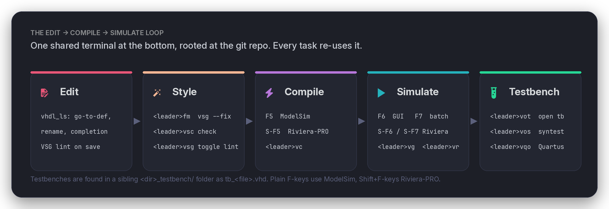
</p>

All tasks send their command to **one shared terminal** at the bottom of the screen, opened in the git root. If you run a second task, it uses the same shell. Your scroll-back and the simulator session stay where they are.

<p align="center">
  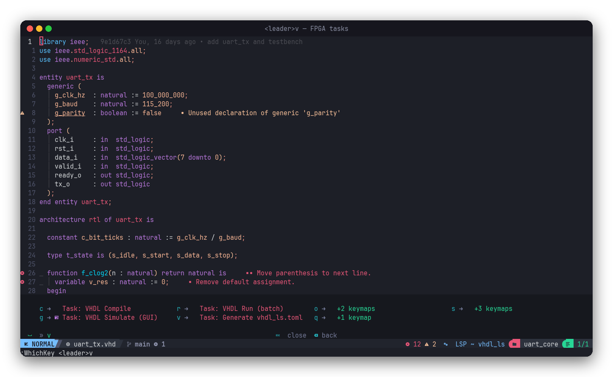
</p>

| Key | Action |
|-----|--------|
| <kbd>F5</kbd> · <kbd>Shift</kbd>+<kbd>F5</kbd> | Compile the current file (ModelSim · Riviera-PRO) |
| <kbd>F6</kbd> · <kbd>Shift</kbd>+<kbd>F6</kbd> | Simulate the matching testbench with the GUI |
| <kbd>F7</kbd> · <kbd>Shift</kbd>+<kbd>F7</kbd> | Run the matching testbench in batch mode |
| <kbd>Space</kbd> <kbd>v</kbd> <kbd>o</kbd> <kbd>t</kbd> / <kbd>s</kbd> | Open the matching testbench / syntest |
| <kbd>Space</kbd> <kbd>v</kbd> <kbd>v</kbd> | Generate `vhdl_ls.toml` for the repo |
| <kbd>Space</kbd> <kbd>v</kbd> <kbd>s</kbd> <kbd>c</kbd> / <kbd>f</kbd> | Run `vsg` check / fix in the terminal |
| <kbd>Space</kbd> <kbd>v</kbd> <kbd>q</kbd> <kbd>o</kbd> | Open the library's Quartus project |

A testbench is found by name. For `rtl/foo.vhd`, the task looks for `rtl_testbench/tb_foo.vhd`. A file named `tb_*` is its own testbench. Some terminals send <kbd>Shift</kbd>+<kbd>F5</kbd>…<kbd>F7</kbd> as `<F17>`…`<F19>`, so both forms are mapped.

### Git: blame, diffs, worktrees

<p align="center">
  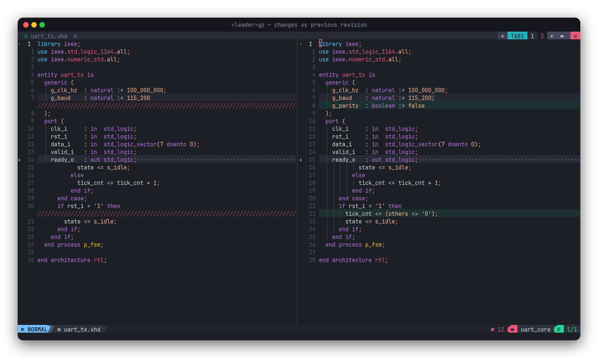
</p>

<kbd>Space</kbd> <kbd>g</kbd> <kbd>p</kbd> (or the back-arrow button at the right of the tab bar) opens **changes vs previous revision**, as in VSCode:

- With uncommitted edits, it diffs `HEAD` against the working file.
- With a clean file, it shows the last commit that touched the file.
- Press it again inside the diff to go back one more commit. Renames are followed. <kbd>q</kbd> closes the diff.

In diff views, changed lines keep their **syntax colours**. Only the background marks what changed. Deleted lines on the other side show as red hatching.

<table>
  <tr>
    <td width="50%">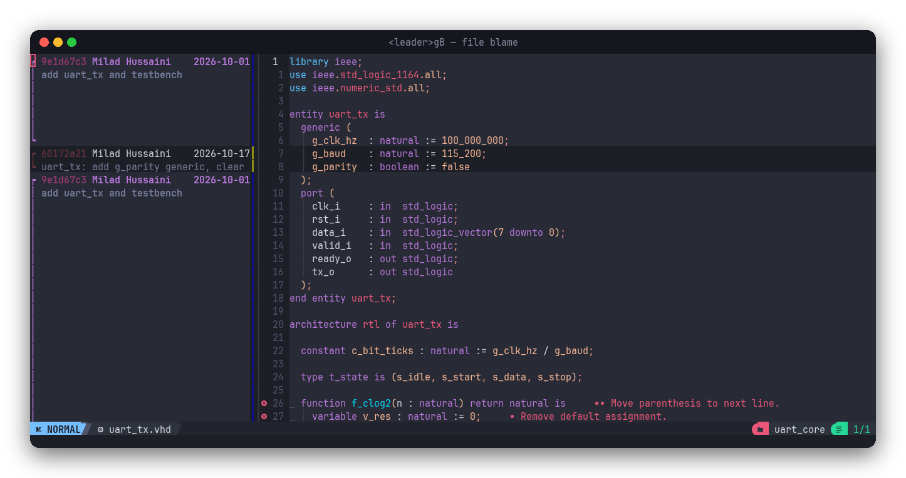</td>
    <td width="50%">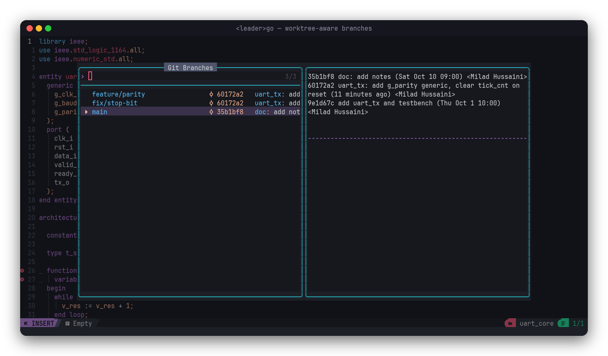</td>
  </tr>
  <tr>
    <td align="center"><b><kbd>Space</kbd> <kbd>g</kbd> <kbd>B</kbd></b> blame the whole file in a side window that scrolls with the code</td>
    <td align="center"><b><kbd>Space</kbd> <kbd>g</kbd> <kbd>o</kbd></b> check out a branch. If it already has a worktree, you jump to that worktree.</td>
  </tr>
</table>

**One tab per worktree.** <kbd>Space</kbd> <kbd>g</kbd> <kbd>n</kbd> checks out any local or remote branch under `~/git/worktrees/<repo>/<branch>` and opens it in a new tab with a tab-local `:tcd`. The tab bar, file tree, LSP roots, gitsigns and pickers all follow the tab you are in. Nothing is stashed and nothing is checked out under your unfinished work. A new worktree gets a copy of the main clone's `vhdl_ls.toml` with its paths rewritten. <kbd>Space</kbd> <kbd>g</kbd> <kbd>W</kbd> lists the worktrees so you can switch to one, make a new one or remove one.

<p align="center">
  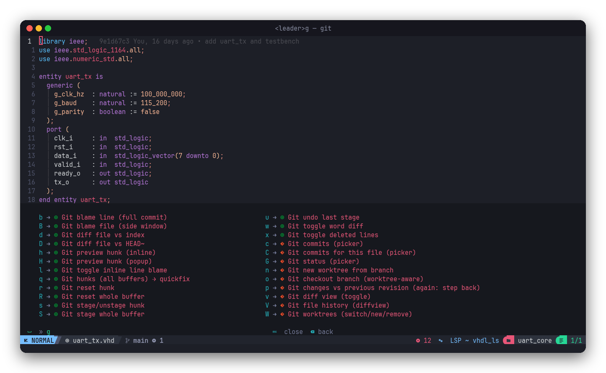
</p>

### Finding and jumping

<table>
  <tr>
    <td width="50%">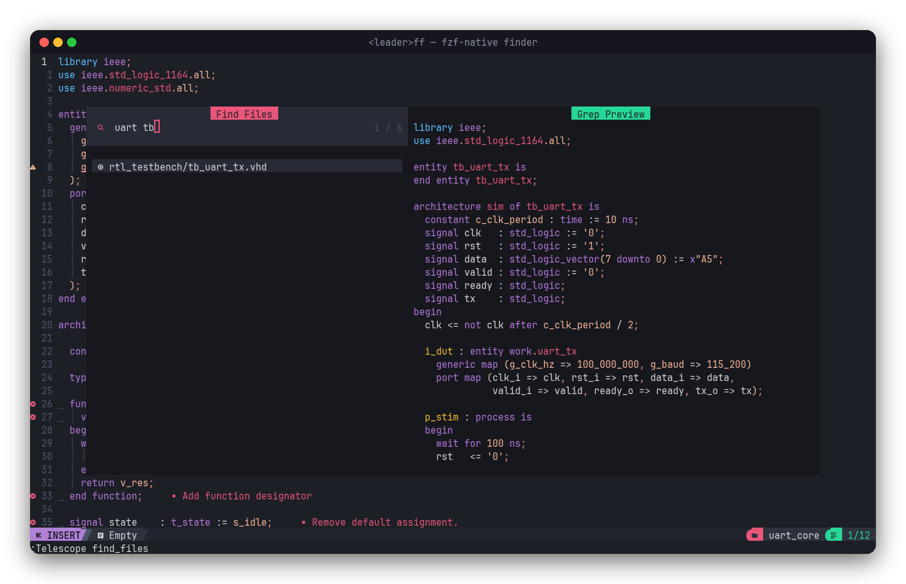</td>
    <td width="50%">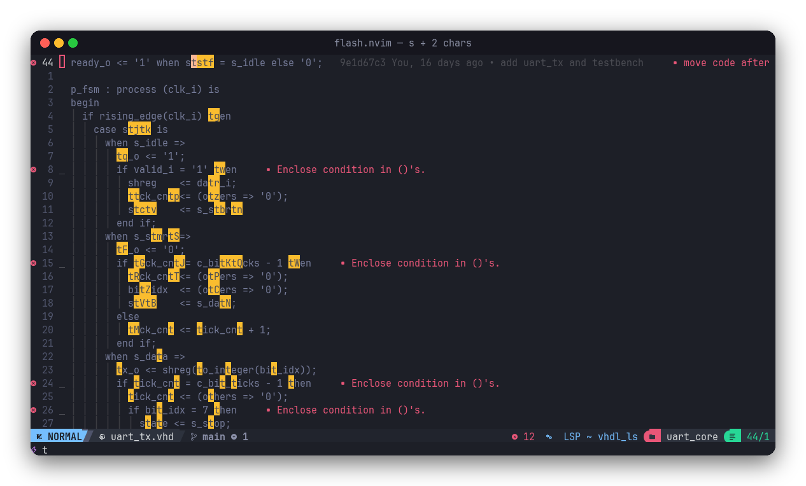</td>
  </tr>
  <tr>
    <td align="center"><b><kbd>Space</kbd> <kbd>f</kbd> <kbd>f</kbd></b> with the fzf-native sorter: words match in any order, so <code>uart tb</code> finds <code>tb_uart_tx.vhd</code>. <code>'exact</code>, <code>^prefix</code>, <code>suffix$</code> and <code>!exclude</code> also work.</td>
    <td align="center"><b><kbd>s</kbd> + 2 chars</b> jumps to any match on screen. <kbd>S</kbd> selects a treesitter node and grows it each time you press it.</td>
  </tr>
</table>

<kbd>Space</kbd> <kbd>f</kbd> <kbd>g</kbd> greps and respects `.gitignore`. <kbd>Space</kbd> <kbd>f</kbd> <kbd>G</kbd> also greps hidden and ignored files, for generated IP or vendor libraries.

### Previews

<p align="center">
  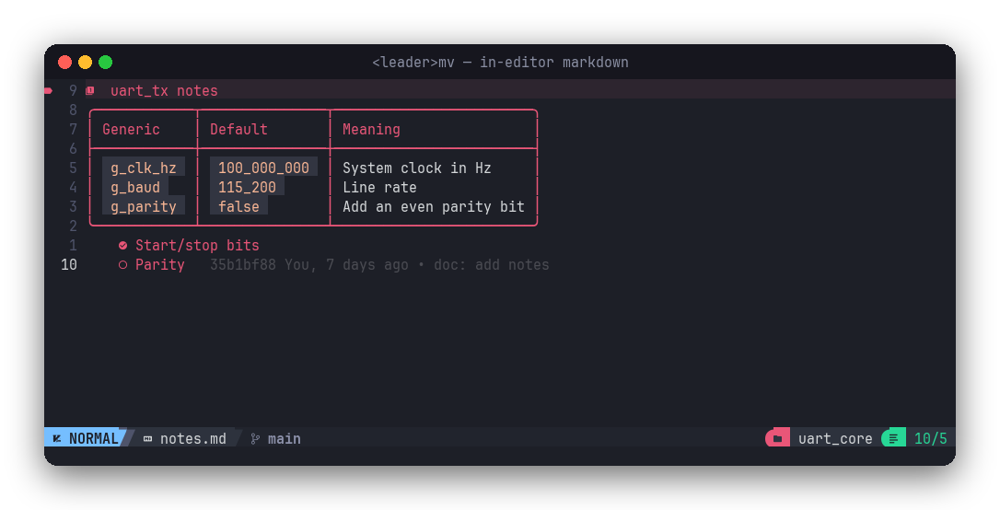
</p>

| Key | What happens |
|-----|--------------|
| <kbd>Space</kbd> <kbd>m</kbd> <kbd>v</kbd> | Renders markdown **inside the editor**: tables, checkboxes, headings, and in kitty also Mermaid diagrams and LaTeX math as images |
| <kbd>Space</kbd> <kbd>m</kbd> <kbd>p</kbd> | Opens the file in **its own Brave window**. Markdown is converted to HTML first. SVG opens in a pan/zoom viewer with text search. HTML, PDF and images open as they are. Unsaved changes are included. |
| open a `.pdf` | Shows it in the browser window. The editor stays where it was. |
| open a `.html` | Opens the rendered page next to the source buffer. |

The SVG viewer works like yEd: the wheel zooms around the pointer, drag pans, <kbd>f</kbd> or a double-click fits the drawing to the window, and <kbd>q</kbd> closes it. It is good for block diagrams.

### The built-in Vim course

<table>
  <tr>
    <td width="55%">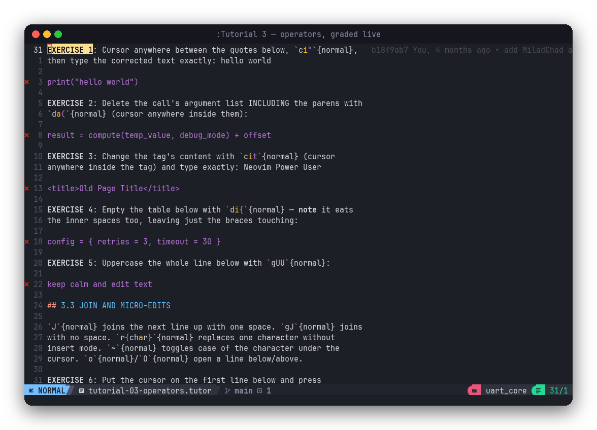</td>
    <td width="45%">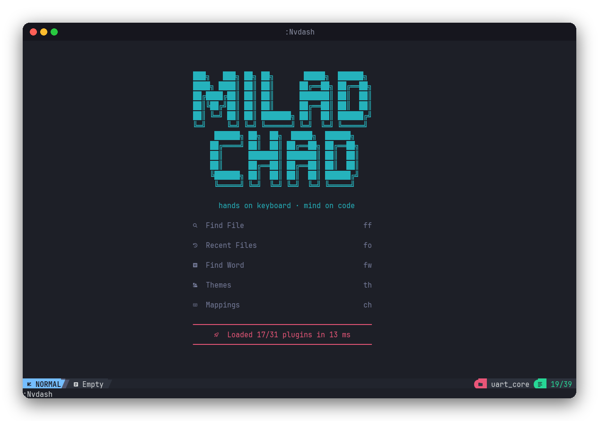</td>
  </tr>
  <tr>
    <td align="center"><b><code>:Tutorial 1</code> … <code>:Tutorial 9</code></b> are interactive lessons. Each exercise line shows ✗ until your edit gives exactly the expected text.</td>
    <td align="center"><b><code>:Nvdash</code></b> opens the dashboard when you want it. Plain <code>nvim</code> opens an empty buffer, ready for typing.</td>
  </tr>
</table>

There are nine chapters, from the basics to power use: motions, operators and text objects, registers, `cgn` and `:g`, macros, marks and quickfix, visual-block tricks, and the IDE keys of this setup. You cannot save a lesson buffer. Run `:Tutorial` again to reset a chapter. If the ✓/✗ signs get out of sync, `:TutorialDoctor` repairs them. The guide is in [`tutor/README.md`](tutor/README.md).

---

## Installation

> [!WARNING]
> This replaces your current Neovim config. Back it up first.

### 1. Requirements

| Needed for | Tool |
|------------|------|
| Core | **Neovim ≥ 0.11** (I use 0.12), `git`, `make`, a C compiler, `unzip`, `ripgrep` |
| Treesitter parsers | `tree-sitter` CLI ≥ 0.26. `~/.cargo/bin` is put first on `PATH`, so an old npm copy cannot shadow it. |
| Icons | A [Nerd Font](https://www.nerdfonts.com/). I use **JetBrainsMono Nerd Font**. |
| Clipboard | `xclip` (X11) or `wl-clipboard` (Wayland) |
| Pyright (Mason) | `npm` |
| VHDL | `vhdl_ls` ([rust_hdl](https://github.com/VHDL-LS/rust_hdl)), `vsg` ([VHDL Style Guide](https://github.com/jeremiah-c-leary/vhdl-style-guide)), `uv` |
| Previews *(optional)* | Brave (falls back to `xdg-open`), `deno`, `mmdc` (Mermaid CLI), ImageMagick, a LaTeX install for math, kitty terminal for images in the editor |

On Ubuntu:

```bash
sudo apt install git make gcc unzip ripgrep xclip python3 npm imagemagick
cargo install --locked tree-sitter-cli
uv tool install vsg                       # or: pipx install vsg
npm install -g @mermaid-js/mermaid-cli    # optional: Mermaid in previews
curl -fsSL https://deno.land/install.sh | sh   # optional: markdown in the browser
```

### 2. Back up and clone

```bash
mv ~/.config/nvim        ~/.config/nvim.bak
mv ~/.local/share/nvim   ~/.local/share/nvim.bak
mv ~/.local/state/nvim   ~/.local/state/nvim.bak
mv ~/.cache/nvim         ~/.cache/nvim.bak

git clone https://github.com/miladi75/nvim ~/.config/nvim
nvim
```

On the first start, lazy.nvim installs itself and every plugin. The treesitter parsers build in the background. Mason installs the language servers, linters and formatters: `lua_ls`, `clangd`, `pyright`, `vhdl_ls`, `stylua`, `clang-format`, `black`, `isort`, `luacheck`, `flake8`. Restart Neovim once when it is done.

### 3. Point it at your `vhdl_ls`

`lua/configs/lspconfig.lua` starts `vhdl_ls` from a binary that I build from source. Change `cmd` to your binary. For example, use the copy that Mason installs:

```lua
vim.lsp.config("vhdl_ls", {
    cmd = { vim.fn.stdpath("data") .. "/mason/bin/vhdl_ls" },
    -- ...
})
```

### 4. Optional extras

```bash
# Patched markdown parser: tables with empty spacer rows stay tables.
~/.config/nvim/scripts/build-markdown-parser.sh

# kitty: open the scroll-back buffer in Neovim (see kitty-scrollback.nvim)
nvim -c KittyScrollbackGenerateKittens
```

Run `:checkhealth` after the first start. `:Mason`, `:Lazy` and `:LspInfo` show what is installed and what is running.

---

## VHDL setup

**Project file.** `vhdl_ls` reads `vhdl_ls.toml` at the repo root. <kbd>Space</kbd> <kbd>v</kbd> <kbd>v</kbd> generates it with the repo's own script. A minimal hand-written file looks like this:

```toml
[libraries]
uart_lib.files = ["rtl/**/*.vhd"]
tb_lib.files   = ["rtl_testbench/**/*.vhd"]
```

The language server starts only for real files on disk. Diffview, fugitive and `term://` buffers do not get a server. Without this check, `vhdl_ls` would get a broken root URI from them.

**VSG rules.** Linting and `--fix` both use the same rule file. The lookup order is in [`lua/configs/vsg.lua`](lua/configs/vsg.lua): first the rule-file paths the repo uses in CI, then `vsg_config.{yaml,yml,json}` searched upwards from the file. If no rule file is found, VSG uses its defaults.

**Colours.** Edit the colour table at the top of `setup_vhdl_colors.py`, then run:

```bash
python3 ~/.config/nvim/setup_vhdl_colors.py           # apply
python3 ~/.config/nvim/setup_vhdl_colors.py --revert  # remove
```

The script rewrites `after/queries/vhdl/highlights.scm` and the block between the `VHDL_COLORS` markers in `lua/chadrc.lua`.

**Tasks.** The FPGA tasks call the repo's own compile and simulate scripts through `uv run`. The script paths, the simulator INI files and the testbench naming rule are at the top of [`lua/fpga_tasks.lua`](lua/fpga_tasks.lua). Change them to match your repo layout.

---

## Keybindings

<p align="center">
  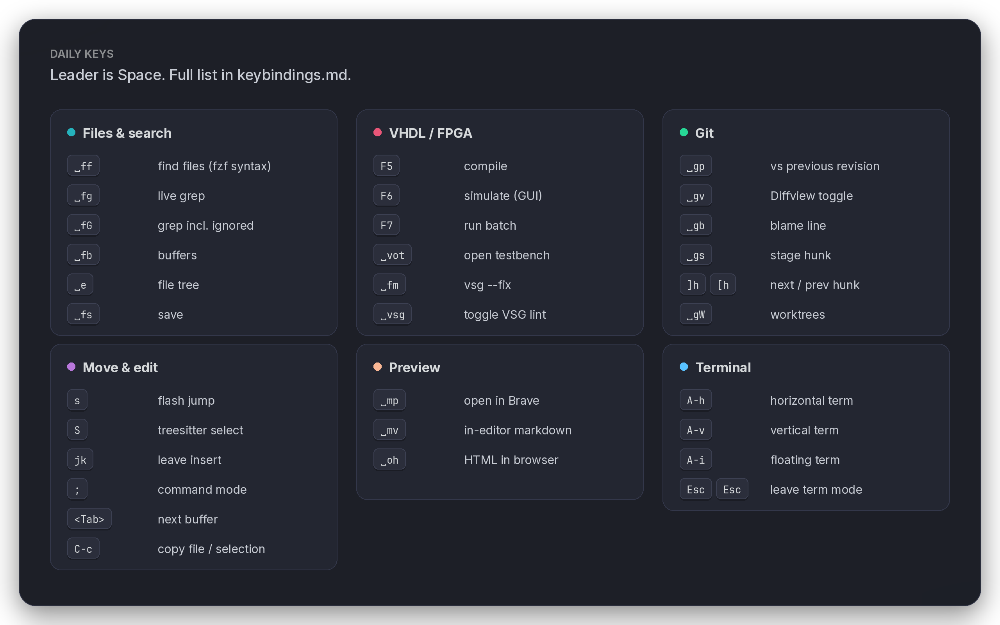
</p>

The leader key is <kbd>Space</kbd>. The full and current list is in **[`keybindings.md`](keybindings.md)**. You can also press <kbd>Space</kbd> and wait: which-key shows what comes next.

<details>
<summary><b>General, buffers and terminal</b></summary>

| Key | Action |
|-----|--------|
| <kbd>;</kbd> | Command mode |
| <kbd>j</kbd><kbd>k</kbd> | Leave insert mode |
| <kbd>Space</kbd> <kbd>f</kbd> <kbd>s</kbd> | Save (<kbd>Ctrl</kbd>+<kbd>s</kbd> is removed because terminal flow control makes it unreliable) |
| <kbd>Space</kbd> <kbd>q</kbd> <kbd>q</kbd> | Quit everything without saving |
| <kbd>Ctrl</kbd>+<kbd>c</kbd> | Copy the file (normal mode) or the selection (visual mode) to the system clipboard |
| <kbd>Tab</kbd> / <kbd>Shift</kbd>+<kbd>Tab</kbd> | Next / previous buffer |
| <kbd>Space</kbd> <kbd>x</kbd> | Close the buffer. On a terminal it only hides it, and the shell keeps running. |
| <kbd>Alt</kbd>+<kbd>h</kbd> / <kbd>v</kbd> / <kbd>i</kbd> | Horizontal / vertical / floating terminal |
| <kbd>Esc</kbd> <kbd>Esc</kbd> | Leave terminal mode |
| <kbd>Space</kbd> <kbd>t</kbd> <kbd>q</kbd> | Kill the terminal buffer |

</details>

<details>
<summary><b>Git</b></summary>

| Key | Action |
|-----|--------|
| <kbd>]</kbd><kbd>h</kbd> / <kbd>[</kbd><kbd>h</kbd> | Next / previous hunk (also in diff windows) |
| <kbd>Space</kbd> <kbd>g</kbd> <kbd>h</kbd> / <kbd>H</kbd> | Preview hunk inline / in a popup |
| <kbd>Space</kbd> <kbd>g</kbd> <kbd>s</kbd> / <kbd>r</kbd> | Stage / reset the hunk or the selected lines |
| <kbd>Space</kbd> <kbd>g</kbd> <kbd>b</kbd> / <kbd>B</kbd> / <kbd>l</kbd> | Blame line / blame file / toggle inline blame |
| <kbd>Space</kbd> <kbd>g</kbd> <kbd>d</kbd> / <kbd>D</kbd> | Diff against the index / `HEAD~` |
| <kbd>Space</kbd> <kbd>g</kbd> <kbd>v</kbd> / <kbd>V</kbd> | Diffview toggle / file history |
| <kbd>Space</kbd> <kbd>g</kbd> <kbd>p</kbd> | Changes vs previous revision (press again to go back one more commit) |
| <kbd>Space</kbd> <kbd>g</kbd> <kbd>c</kbd> / <kbd>C</kbd> / <kbd>G</kbd> | Commits (repo / file) and status pickers |
| <kbd>Space</kbd> <kbd>g</kbd> <kbd>W</kbd> / <kbd>n</kbd> / <kbd>o</kbd> | Worktrees / new worktree / worktree-aware checkout |
| `ih` | Hunk text object (`dih`, `yih`, `vih`) |

</details>

<details>
<summary><b>Tutorial and useful commands</b></summary>

| Command | Action |
|---------|--------|
| `:Tutorial [n\|name]` | Open the course or one chapter. <kbd>Tab</kbd> completes the chapter names. |
| `:TutorialDoctor` | Check and re-sync the ✓/✗ signs |
| `:Nvdash` | Dashboard |
| `:Mason` · `:Lazy` · `:LspInfo` · `:checkhealth` | Tools, plugins, servers, health |

</details>

---

## What is in the box

| Area | Plugins and tools |
|------|-------------------|
| Base | NvChad 2.5 UI, base46 theme **horizon**, lazy.nvim, which-key |
| Completion | blink.cmp with friendly-snippets (replaces nvim-cmp and LuaSnip) |
| LSP | nvim-lspconfig on the Neovim 0.11 `vim.lsp.config` API: `vhdl_ls`, `clangd` (finds `compile_commands.json` in `build/` and `cmake-build-*`), `pyright`, `lua_ls` |
| Lint · format | nvim-lint (`vsg`, `luacheck`, `flake8`) · conform.nvim (`vsg`, `stylua`, `clang-format`, `black` + `isort`), all installed by Mason |
| Syntax | nvim-treesitter `main` branch with Neovim's own highlighting, indent and folds. Parsers: VHDL, C/C++, Python, Lua, Bash, Markdown, LaTeX, YAML, TOML and more. |
| Navigation | Telescope + fzf-native, nvim-tree, flash.nvim |
| Git | gitsigns, diffview.nvim, snacks.nvim pickers, own modules `worktree.lua` and `git_prev_revision.lua` |
| Docs | markview.nvim, snacks.nvim images (Mermaid, LaTeX), `scripts/preview.sh` + `svg-viewer.js` |
| Terminal | NvChad terms, kitty-scrollback.nvim |

---

## Repository layout

```text
~/.config/nvim
├── init.lua                     bootstrap lazy.nvim, load NvChad, theme, mappings
├── keybindings.md               the full key reference
├── setup_vhdl_colors.py         generates the VHDL highlight rules
├── after/queries/vhdl/          treesitter highlight rules for the naming convention
├── lua/
│   ├── chadrc.lua               theme, tab bar buttons, dashboard, diff colours
│   ├── options.lua              indent 4, folds, PATH, diff fill characters
│   ├── mappings.lua             all custom keys, previews, :Tutorial
│   ├── fpga_tasks.lua           F5/F6/F7 compile and simulate, testbench lookup
│   ├── worktree.lua             one tab per git worktree
│   ├── git_prev_revision.lua    "changes vs previous revision"
│   ├── plugins/init.lua         plugin list
│   └── configs/                 lspconfig, lint, vsg, conform, treesitter, gitsigns, diffview …
├── scripts/                     browser preview, SVG viewer, markdown parser patch
├── tutor/                       the nine-chapter Vim course and its check files
└── assets/                      README images
```

---

## Make it yours

- **Theme:** <kbd>Space</kbd> <kbd>t</kbd> <kbd>h</kbd> opens the picker. Set the default with `theme` in `lua/chadrc.lua`. The VHDL colours follow the theme.
- **Keys:** put them in `lua/mappings.lua`. NvChad 2.5 does not read `M.mappings` from `chadrc.lua`. Update `keybindings.md` too, so it stays the single source of truth.
- **Languages:** add the server to `lspconfig.servers` in `lua/configs/lspconfig.lua`, the linter to `lua/configs/lint.lua`, the formatter to `lua/configs/conform.lua` and the parser to `lua/configs/treesitter.lua`. Mason installs whatever is listed.
- **Worktree location:** `vim.g.worktree_root = "/some/dir"`.
- **File tree width:** `lua/configs/nvimtree.lua`.

---

## License

[MIT](LICENSE) © 2026 Milad Hussaini
